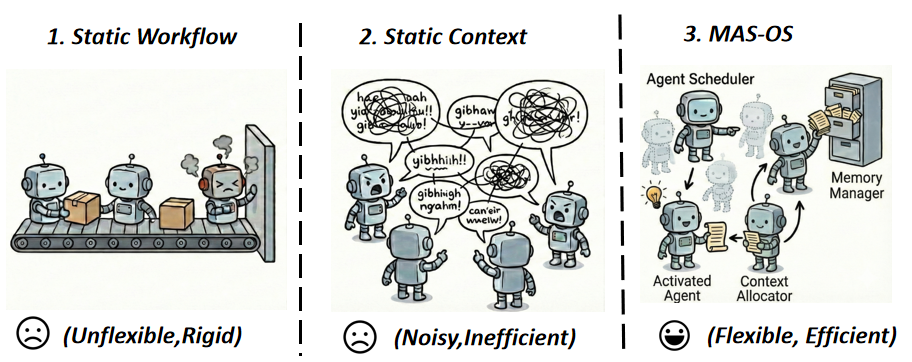
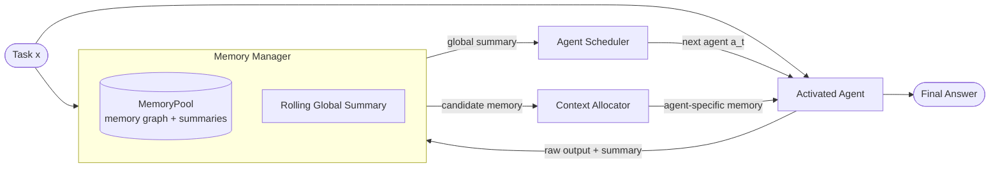
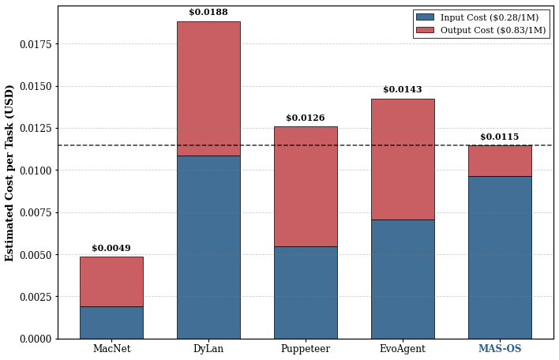

<div align="center">

# MAS-OS: Collaborative Operating System of Multi-Agent Systems

**Memory-centric agent scheduling and context allocation for long-horizon multi-agent collaboration.**

<p>
  <a href="docs/MAS-OS_EMNLP_2026.pdf"></a>
  <a href="docs/MAS-OS_EMNLP_2026.pdf"></a>
  <a href="https://github.com/BAI-LAB/MAS-OS"></a>
  
  <a href="https://github.com/BAI-LAB/MAS-OS"></a>
</p>

<p>
  <b>Jiazheng Kang</b><sup>1</sup> &nbsp;·&nbsp;
  <b>Ruochen Zhao</b><sup>1</sup> &nbsp;·&nbsp;
  <b>Gezi Li</b><sup>2</sup> &nbsp;·&nbsp;
  <b>Dongying Lin</b><sup>2</sup> &nbsp;·&nbsp;
  <b>Ting Bai</b><sup>1,†</sup>
</p>

<p>
  <sup>1</sup>Beijing University of Posts and Telecommunications &nbsp;&nbsp;
  <sup>2</sup>Huawei Technologies Co., Ltd.
</p>

<p>
  <sup>†</sup>Corresponding author: <a href="mailto:baiting@bupt.edu.cn">baiting@bupt.edu.cn</a>
</p>

<p><b>Accepted to EMNLP 2026</b></p>

</div>

---

## 📄 Abstract

Large language model-driven Multi-Agent Systems (MAS) face two key challenges in long-horizon tasks: collaboration workflows struggle to adapt to dynamic task states, and accumulated inter-agent interactions lead to lengthy, noisy contexts that degrade model performance and efficiency. To address these challenges, we propose **MAS-OS**, a collaborative Operating System (OS) for MAS. MAS-OS consists of three core modules: a **Memory Manager**, an **Agent Scheduler**, and a **Context Allocator**. The Memory Manager maintains a structured memory pool and a global summary of agents' interaction history. Based on the evolving memory states, the Agent Scheduler selects the next active agent, while the Context Allocator provides task-relevant memories to support effective context utilization. Experiments on four benchmark datasets demonstrate the effectiveness of MAS-OS. Compared with SOTA baselines, MAS-OS achieves an average improvement of **17.42%** under the Llama-3.1-8B backbone.

<p align="center">
  
</p>

<p align="center">
  <em>MAS-OS replaces rigid static workflows and noisy full-context broadcasting with a flexible OS that schedules agents and routes memory on demand.</em>
</p>

## ✨ Highlights

- **OS-level abstraction for MAS** — frames multi-agent collaboration as a resource-management problem with unified memory management, agent scheduling, and context routing.
- **Graph-structured MemoryPool** — memory units, temporal edges, semantic edges, and a rolling global summary preserve long-range task state.
- **Memory-driven scheduling** — the next agent is selected from the evolving memory state rather than a fixed DAG or hand-crafted workflow.
- **Agent-conditioned context allocation** — each active agent receives a compact, relevant memory subset instead of the full interaction history.
- **Joint RL optimization** — the Scheduler and Allocator are trained together with RLOO/PPO and a KL penalty, using a dual-LoRA setup on Llama-3.1-8B.
- **Strong and efficient results** — new SOTA on GSM-Hard, SciBench, and SRDD, competitive results on MMLU-Pro, and the lowest output-token consumption among compared methods.

## 🧩 Framework

MAS-OS treats the multi-agent system as an operating system whose kernel manages memory, compute (agents), and communication (context).



| Module | Responsibility | Code |
| :--- | :--- | :--- |
| **Memory Manager** | Builds the graph-based MemoryPool, maintains temporal/semantic edges, and updates the rolling global summary. | [`memer.py`](mas_os/mas_scheduler/memer.py) |
| **Agent Scheduler** | Selects the next active agent conditioned on the task, global summary, previous agent, and its memory. | [`scheduler.py`](mas_os/mas_scheduler/scheduler.py), [`lora_scheduler.py`](mas_os/mas_scheduler/lora_scheduler.py) |
| **Context Allocator** | Retrieves candidate memories from the graph and selects an agent-specific context within a budget. | [`router.py`](mas_os/mas_scheduler/router.py), [`lora_router.py`](mas_os/mas_scheduler/lora_router.py) |
| **RL training** | Dual-LoRA training of the Scheduler and Router with RLOO, PPO, and KL regularization. | [`mas_dual_lora_workflow.py`](MARTI/marti/worlds/workflows/mas_dual_lora_workflow.py) |

## 📊 Results

**Main results.** Accuracy on four benchmarks with Llama-3.1-8B and Llama-3.1-70B. Best results are in **bold**; `*` marks statistically significant improvements over the SOTA baseline (paired two-sided t-test, p < 0.05).

| Model | Method | GSM-Hard | SciBench | SRDD | MMLU-Pro |
| :--- | :--- | ---: | ---: | ---: | ---: |
| **Llama-3.1-8B** | Base Model | 0.0021 | 0.0920 | 0.4615 | 0.3900 |
| | AFlow | 0.2763 | 0.1653 | 0.6417 | 0.3270 |
| | DyLAN | 0.2170 | 0.1156 | 0.6627 | 0.3040 |
| | MacNet | 0.1172 | 0.1940 | 0.6812 | 0.3640 |
| | EvoAgent | 0.2323 | 0.2053 | 0.6940 | 0.3170 |
| | Puppeteer | 0.1940 | 0.1766 | 0.6847 | 0.3540 |
| | MAS-OS (-RL) | 0.2890 | 0.2548 | 0.6954 | 0.3130 |
| | **MAS-OS** | **0.3150\*** | **0.2782\*** | **0.7131\*** | **0.3760** |
| **Llama-3.1-70B** | Base Model | 0.1021 | 0.2687 | 0.8133 | 0.5480 |
| | AFlow | 0.5179 | 0.3376 | 0.8372 | 0.5050 |
| | DyLAN | 0.4358 | 0.3265 | 0.8411 | 0.5320 |
| | MacNet | 0.2447 | 0.2847 | 0.8524 | 0.3520 |
| | EvoAgent | 0.3975 | 0.3423 | 0.8496 | 0.4380 |
| | **MAS-OS (-RL)** | **0.6313\*** | **0.3757\*** | **0.8667\*** | **0.6040\*** |

<sub>MAS-OS (-RL) removes RL fine-tuning while keeping dynamic scheduling and selective context allocation. On Llama-3.1-8B, MAS-OS improves over the strongest baseline by **+14.01%** on GSM-Hard, **+35.51%** on SciBench, and **+2.75%** on SRDD.</sub>

<br>

<details>
<summary><b>Efficiency and cost analysis</b></summary>

<br>

MAS-OS keeps execution-token overhead moderate while achieving the **lowest inference (output) token consumption** among all compared methods, reducing inference latency by more than 30% compared with EvoAgent.

| Method | Execution Tokens | Inference Tokens | Total Tokens | Time (s) |
| :--- | ---: | ---: | ---: | ---: |
| MacNet | 6,787 | 3,556 | 10,343 | 21.02 |
| DyLAN | 38,778 | 9,602 | 48,381 | 46.41 |
| Puppeteer | 19,590 | 8,559 | 26,649 | 42.31 |
| EvoAgent | 25,306 | 8,632 | 33,938 | 70.82 |
| **MAS-OS** | 34,156 | **2,179** | 38,635 | 49.03 |

<p align="center">
  
</p>

<p align="center"><em>Estimated average cost per GSM-Hard task. Output tokens dominate production API cost.</em></p>

</details>

<details>
<summary><b>Ablation study</b></summary>

<br>

Removing any kernel component degrades performance; the Context Allocator has the largest effect.

| Method | GSM-Hard | SciBench | SRDD |
| :--- | ---: | ---: | ---: |
| w/o Context Allocator | 0.233 (−26.1%) | 0.184 (−33.9%) | 0.659 (−7.6%) |
| w/o Memory Manager | 0.251 (−20.2%) | 0.204 (−26.8%) | 0.676 (−5.2%) |
| w/o Agent Scheduler | 0.282 (−10.6%) | 0.262 (−5.8%) | 0.688 (−3.6%) |
| **MAS-OS** | **0.315** | **0.278** | **0.713** |

</details>

## 📦 Installation

**Requirements:** Python ≥ 3.10, CUDA-capable GPUs, and a working Ray + vLLM setup.

```bash
git clone https://github.com/BAI-LAB/MAS-OS.git
cd MAS-OS

conda create -n mas-os python=3.10 -y
conda activate mas-os

# Agent runtime and tooling
pip install -r requirements.txt

# Training stack (MARTI + verl + vLLM); install last to pin the training versions
pip install -r MARTI/requirements.txt
```

MARTI is launched from source by the Ray job (its working directory is added to the runtime environment), so no separate package install is required.

The reference scripts assume two GPUs for vLLM tensor parallelism (`--tensor-parallel-size 2`). Adjust GPU counts and per-role device settings in the launch scripts to match your hardware.

## 🚀 Quick Start

### 1. Serve the backbone with vLLM

Start an OpenAI-compatible vLLM server with LoRA support. Runtime LoRA updating lets training push fresh adapters to the server.

```bash
export CUDA_VISIBLE_DEVICES=0,1
export VLLM_ALLOW_RUNTIME_LORA_UPDATING=True
export VLLM_LORA_SERVER_URL="http://127.0.0.1:8000"

vllm serve meta-llama/Llama-3.1-8B \
  --host 0.0.0.0 --port 8000 \
  --dtype bfloat16 \
  --tensor-parallel-size 2 \
  --enable-lora \
  --max-lora-rank 16 \
  --max-loras 2
```

### 2. Start the Ray cluster

```bash
ray start --head --dashboard-host=0.0.0.0 --dashboard-port=8265
```

The Ray dashboard is available at `http://localhost:8265`.

### 3. Train the Scheduler and Router

```bash
bash MARTI/scripts/run_train_mas_dual_lora_grpo.sh meta-llama/Llama-3.1-8B gsm-hard
```

Supported task names: `gsm-hard`, `scibench`, `srdd`, `mmlu-pro` (and `cw` for creative writing). Checkpoints and dual-LoRA adapters are written under `MARTI/outputs/`.

### 4. Evaluate a trained checkpoint

`CKPT_DIR` must contain the `scheduler_lora/` and `router_lora/` adapter directories produced by training. Evaluation reuses the vLLM server from step 1 and loads both adapters at runtime.

```bash
bash MARTI/scripts/run_eval_mas_dual_lora.sh \
  meta-llama/Llama-3.1-8B <CKPT_DIR> gsm-hard
```

Optional arguments: `<DATA_LIMIT> <MAX_STEPS> <RESUME_FROM>`.

### 5. Run inference without trained adapters

The OS pipeline can also run on top of a plain vLLM server:

```bash
cd mas_os
python main_mas_vllm.py gsm-hard test \
  --model meta-llama/Llama-3.1-8B \
  --base_url http://localhost:8000/v1 \
  --data_limit 10
```

## 📁 Repository Layout

```text
MAS-OS/
├── MARTI/                       # RL training framework (verl-based)
│   ├── marti/                   # trainers, worlds, workflows, verifiers
│   └── scripts/                 # training / evaluation launch scripts
├── mas_os/                   # Agent runtime and MAS scheduler
│   ├── mas_scheduler/           # Memory Manager, Scheduler, Context Allocator
│   ├── agent/ tasks/ tools/     # agents, benchmarks, tools
│   ├── data/                    # GSM-Hard, SciBench, SRDD, MMLU-Pro
│   └── main_mas_vllm.py         # inference entry point
├── docs/                        # paper and figures
│   ├── MAS-OS_EMNLP_2026.pdf
│   └── assets/
├── requirements.txt
└── CITATION.cff
```

## 📚 Benchmarks

The repository ships the evaluation splits used in the paper under `mas_os/data/`.

| Benchmark | Task | Metric | Test Examples |
| :--- | :--- | :--- | ---: |
| [GSM-Hard](mas_os/data/GSM-Hard) | Grade-school math with large numbers | Accuracy | 919 |
| [SciBench](mas_os/data/scibench) | College-level scientific problem solving | Accuracy | 492 |
| [SRDD](mas_os/data/SRDD) | Software generation from specifications | Quality score (completeness, executability, consistency) | 1,000 |
| [MMLU-Pro](mas_os/data/MMLU-Pro) | Multidisciplinary 10-way multiple choice | Accuracy | 500 |

Each benchmark also includes a 200-example training split.

## 📝 Citation

If you find MAS-OS useful in your research, please cite:

```bibtex
@inproceedings{kang2026masos,
  title     = {Collaborative Operating System of Multi-Agent Systems},
  author    = {Kang, Jiazheng and Zhao, Ruochen and Li, Gezi and Lin, Dongying and Bai, Ting},
  booktitle = {Proceedings of the 2026 Conference on Empirical Methods in Natural Language Processing (EMNLP)},
  year      = {2026}
}
```

A machine-readable entry is also available in [`CITATION.cff`](CITATION.cff).

## 🙏 Acknowledgements

This work was supported in part by the National Natural Science Foundation of China (Grant No. 62236003). We thank the authors of MARTI, verl, vLLM, and the evaluated benchmarks for making their code and data available.

## 📬 Contact

For questions about the paper or code, please contact
[Ting Bai](mailto:baiting@bupt.edu.cn) or [Jiazheng Kang](mailto:kjz@bupt.edu.cn),
or open an issue in this repository.
